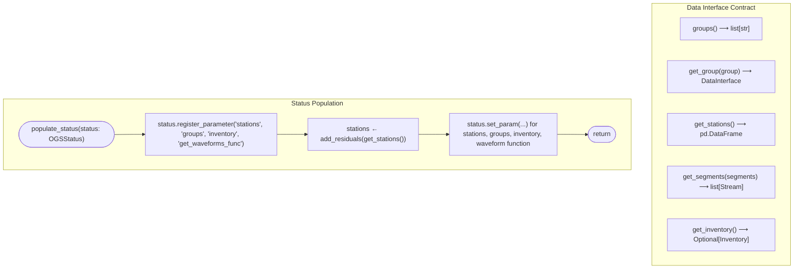

# Pseudocode Map: OGSAbstractDataSource

## Purpose
Abstract base class specifying the acquisition contract for seismic data sources, defining group discovery, lazy waveform fetching, station inventories, velocity models, and station travel-time residuals.

## Current Execution Flow


## Pseudocode
```text
abstract class OGSAbstractDataSource:
  field velocity_model: Option(DataFrame)
  field residuals_path: Option(Path)

  abstract method groups() ⟶ List(String)
  abstract method get_group(group: String) ⟶ DataInterface
  abstract method get_stations() ⟶ DataFrame
  abstract method get_segments(segments: DataFrame) ⟶ List(Stream)

  method add_residuals(stations: DataFrame) ⟶ DataFrame:
    if self.residuals_path = None ∨ ¬exists(self.residuals_path) then:
      ⟵ stations
    residuals ← read_csv(self.residuals_path)
    ⟵ merge(stations, residuals, on="id", how="left")

  method populate_status(status: OGSStatus) ⟶ None:
    status.register_parameter("stations")
    status.register_parameter("groups")
    status.register_parameter("inventory")
    status.register_parameter("get_waveforms_func")
    if self.velocity_model ≠ None then:
      status.set_param(self.velocity_model, "velocity_model", "data")
    stations ← self.add_residuals(self.get_stations())
    status.set_param(stations, "stations", "data")
    status.set_param(self.groups(), "groups", "data")
    inv ← self.get_inventory()
    if inv ≠ None then:
      status.set_param(inv, "inventory", "data")
    status.set_param(self.get_segments, "get_waveforms_func", "data")
```

## State and Responsibilities
| Field / Method | Responsibility | Epistemic Status |
|:---|:---|:---|
| `groups()` | Abstract group partition discovery (e.g., calendar days) | **observed** ([OGS/src/ogsdata.py:169-171](OGS/src/ogsdata.py#L169-L171)) |
| `get_group()` | Abstract stream/data callable provider for a given group | **observed** ([OGS/src/ogsdata.py:173-175](OGS/src/ogsdata.py#L173-L175)) |
| `add_residuals()` | Joins empirical station delays into station inventory DataFrame | **observed** ([OGS/src/ogsdata.py:191-195](OGS/src/ogsdata.py#L191-L195)) |
| `populate_status()` | Publishes dataset metadata and wave stream closures to `OGSStatus` | **observed** ([OGS/src/ogsdata.py:197-217](OGS/src/ogsdata.py#L197-L217)) |

## Tests and Evidence
- Implemented and extended by `OGSSquirrelDataSource` ([OGS/src/ogsdata.py:927-1761](OGS/src/ogsdata.py#L927-L1761)).

