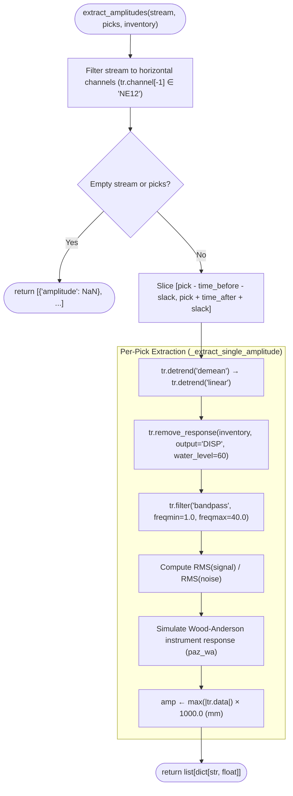

# Pseudocode Map: OGSAmplitudeExtractor

## Purpose
Measures Wood-Anderson peak horizontal displacement amplitudes (in mm) and signal-to-noise ratio (SNR) metrics around SeisBench neural picks using instrument response deconvolution, linear detrending, and 1-40 Hz bandpass filtering.

## Current Execution Flow


## Pseudocode
```text
class OGSAmplitudeExtractor:
  field time_before: Float
  field time_after: Float
  field slack: Float
  field components: String = "NE12"
  field freq_range: Tuple(Float, Float) = (1.0, 40.0)

  method _extract_single_amplitude(window: Stream, pick: Pick, inv: Inventory) ⟶ Dict(String, Float):
    if window = None ∨ |window| = 0 ∨ inv = None then:
      ⟵ {amplitude: NaN}

    # Signal conditioning
    window.detrend("demean")
    window.detrend("linear")
    window.remove_response(inventory=inv, output="DISP", water_level=60)
    window.filter("bandpass", freqmin=1.0, freqmax=40.0)

    # Noise window: [pick − slack .. pick − 0.1s]
    # Signal window: [pick .. pick + slack]
    noise_rms ← rms(window.slice(pick − self.slack, pick − 0.1))
    signal_rms ← rms(window.slice(pick, pick + self.slack))
    snr ← signal_rms / noise_rms

    # Wood-Anderson displacement
    window.simulate(paz_remove=None, paz_simulate=paz_wa)
    amp_mm ← max(|window.data|) × 1000.0

    ⟵ {amplitude: amp_mm, snr: snr}
```

## State and Responsibilities
| Field / Method | Responsibility | Epistemic Status |
|:---|:---|:---|
| `extract_amplitudes()` | Prepares waveform windows and dispatches single or parallel extractions | **observed** ([OGS/src/ogspicker.py:116-165](OGS/src/ogspicker.py#L116-L165)) |
| `_extract_single_amplitude()` | Applies deconvolution, filtering, SNR computation, and WA simulation | **observed** ([OGS/src/ogspicker.py:166-260](OGS/src/ogspicker.py#L166-L260)) |
| `self.components` | Allowed horizontal channel component identifiers | **observed** ([OGS/src/ogspicker.py:104](OGS/src/ogspicker.py#L104)) |

## Tests and Evidence
- Verified via `OGSSeisBenchPicker` tests in [OGS/test/](OGS/test/).

