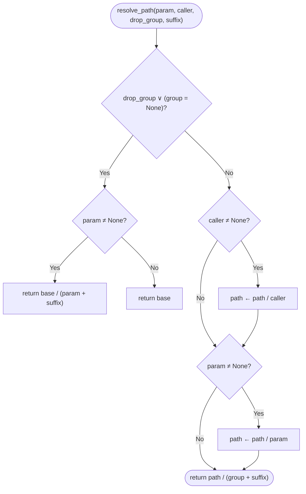

# Pseudocode Map: OGSCacheHelper

## Purpose
Resolves hierarchical filesystem cache paths for intermediate pipeline outputs matching the exact `<output_path>/<caller>/<param>/<group>.parquet` on-disk layout, or `<output_path>/<param>.parquet` for global artifacts.

## Current Execution Flow


## Pseudocode
```text
function resolve_path(param: Option(String), caller: Option(String), drop_group: Bool, suffix: String) ⟶ Path:
  base ← self.output_path
  if drop_group ∨ self.group = None then:
    if param ≠ None then:
      ⟵ base / (param ⧺ suffix)
    ⟵ base
  path ← base
  if caller ≠ None then:
    path ← path / caller
  if param ≠ None then:
    path ← path / param
  ⟵ path / (self.group ⧺ suffix)

function get_cache_path(param, caller, drop_group, suffix, mode) ⤅ Path:
  file_path ← resolve_path(param, caller, drop_group, suffix)
  if "w" ∈ mode then:
    file_path.parent.mkdir(parents=⊤, exist_ok=⊤)
  ⤅ file_path
```

## State and Responsibilities
| Field / Method | Responsibility | Epistemic Status |
|:---|:---|:---|
| `self.output_path: Path` | Absolute base directory path for artifacts | **observed** ([OGS/src/ogsbase.py:65](OGS/src/ogsbase.py#L65)) |
| `self.group: Option(str)` | Optional partition identifier (calendar day) | **observed** ([OGS/src/ogsbase.py:66](OGS/src/ogsbase.py#L66)) |
| `resolve_path()` | Builds deterministic Parquet filepath | **observed** ([OGS/src/ogsbase.py:68-86](OGS/src/ogsbase.py#L68-L86)) |
| `get_cache_path()` | Context manager auto-creating parent directories | **observed** ([OGS/src/ogsbase.py:88-103](OGS/src/ogsbase.py#L88-L103)) |

## Tests and Evidence
- Verified in [OGS/test/testogsbase.py:38-70](OGS/test/testogsbase.py#L38-L70).
