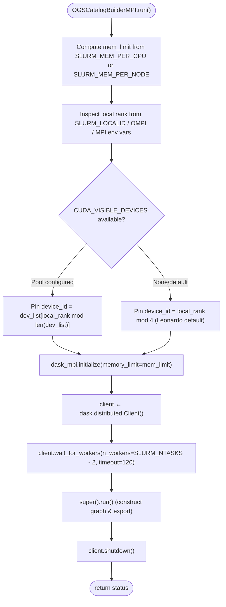

# Pseudocode Map: OGSCatalogBuilderMPI

## Purpose
Distributed `OGSCatalogBuilder` subclass that bootstraps Dask-MPI, assigns CUDA devices by local rank, executes configured modules across cluster workers, and exports unified catalog artifacts on Leonardo HPC.

## Current Execution Flow


## Pseudocode
```text
function run() ⟶ OGSStatus:
  # Memory resolution
  if SLURM_MEM_PER_CPU ≠ None then:
    mem_limit ← (SLURM_MEM_PER_CPU × SLURM_CPUS_PER_TASK) ⧺ "MB"
  else if SLURM_MEM_PER_NODE ≠ None then:
    mem_limit ← SLURM_MEM_PER_NODE ⧺ "MB"
  else:
    mem_limit ← "8000MB"

  # GPU pinning before importing PyTorch / CUDA
  local_rank ← get_local_rank() ⫽ 0
  if CUDA_VISIBLE_DEVICES has "," then:
    devs ← split(CUDA_VISIBLE_DEVICES, ",")
    CUDA_VISIBLE_DEVICES ← devs[local_rank mod |devs|]
  else if CUDA_VISIBLE_DEVICES = None then:
    CUDA_VISIBLE_DEVICES ← local_rank mod 4

  if dask_mpi = None ∨ ¬hasattr(dask_mpi, "initialize") then:
    raise RuntimeError("dask_mpi not installed")
  dask_mpi.initialize(memory_limit=mem_limit)

  client ← dask.distributed.Client()
  if SLURM_NTASKS > 2 then:
    client.wait_for_workers(n_workers=SLURM_NTASKS − 2, timeout=120)

  try:
    status ← super().run()
    ⟵ status
  finally:
    client.shutdown()
```

## State and Responsibilities
| Field / Method | Responsibility | Epistemic Status |
|:---|:---|:---|
| `run()` | Orchestrates MPI bootstrap, GPU isolation, graph execution, and graceful teardown | **observed** ([OGS/src/ogsbuilderMPI.py:58-135](OGS/src/ogsbuilderMPI.py#L58-L135)) |
| Rank detection | Multi-scheduler parsing (`SLURM_LOCALID`, `OMPI_COMM_WORLD_LOCAL_RANK`, `MPI_LOCALRANKID`) | **observed** ([OGS/src/ogsbuilderMPI.py:75-80](OGS/src/ogsbuilderMPI.py#L75-L80)) |
| GPU Pinning | Deterministic modulo device assignment preventing CUDA device contention | **observed** ([OGS/src/ogsbuilderMPI.py:84-101](OGS/src/ogsbuilderMPI.py#L84-L101)) |
| Client Lifecycle | Guaranteed cluster connection cleanup via `try...finally` | **observed** ([OGS/src/ogsbuilderMPI.py:130-135](OGS/src/ogsbuilderMPI.py#L130-L135)) |

## Tests and Evidence
- Leonardo MPI execution topology documented in [LLM/01_context/pipeline_map.md](LLM/01_context/pipeline_map.md).

