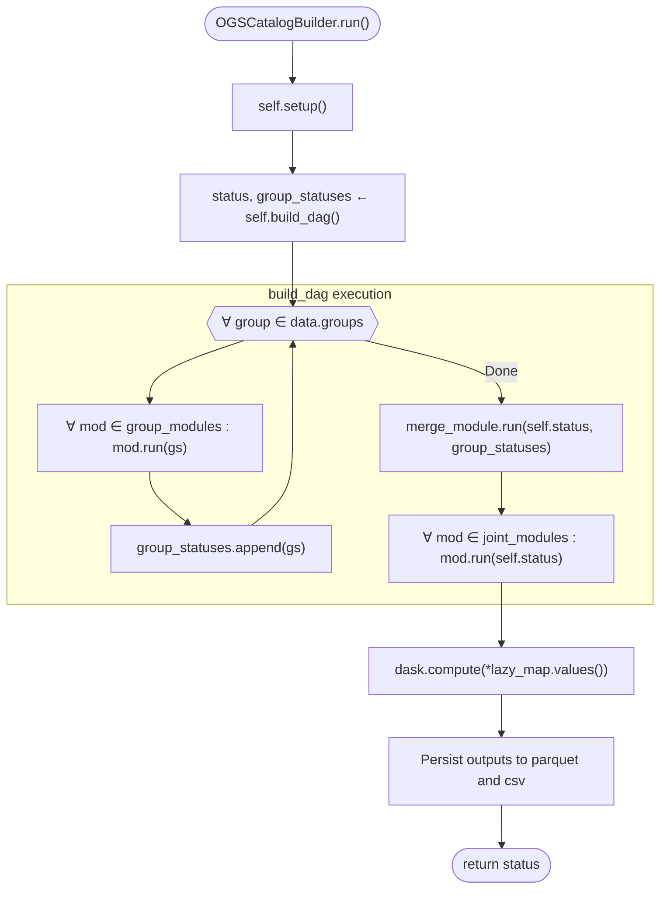

# Pseudocode Map: OGSCatalogBuilder

## Purpose
Master DAG orchestrator building lazy Dask computation graphs across daily partitions, executing group stages, invoking `OGSMerge`, applying joint modules, evaluating lazy tasks, and serializing catalog artifacts to Parquet and CSV files.

## Current Execution Flow


## Pseudocode
```text
function build_dag() ⟶ ⟨OGSStatus, List(OGSGroupStatus)⟩:
  group_statuses ← []
  groups ← self.data.get_groups() ⫽ []

  ∀ group ∈ groups:
    gs ← OGSGroupStatus(group, self.output_path)
    if hasattr(self.data, "get_group") then:
      gs.set_param(λ. self.data.get_group(group), "data_func")
    ∀ mod ∈ self.group_modules:
      if hasattr(mod, "run") then:
        mod.run(gs)
    group_statuses.append(gs)

  # Invocation point of merger across group states
  if self.merge_module ≠ None ∧ hasattr(self.merge_module, "run") then:
    self.merge_module.run(self.status, group_statuses)

  ∀ mod ∈ self.joint_modules:
    if hasattr(mod, "run") then:
      mod.run(self.status)

  ⟵ ⟨self.status, group_statuses⟩

function run() ⟶ OGSStatus:
  self.setup()
  ⟨status, _⟩ ← self.build_dag()
  lazy_map ← {k: status._parameters[k].payload | k ∈ self.outputs if is_dask(payload)}
  if lazy_map ≠ ∅ then:
    results ← dask.compute(*lazy_map.values())
    ∀ ⟨k, res⟩ ∈ zip(lazy_map.keys(), results):
      status._parameters[k] ← ⟨res, _identity, ⊤⟩
  ∀ key ∈ self.outputs:
    val ← status.get_param(key)
    if val is pd.DataFrame then:
      ∀ fmt ∈ self.formats:
        export_table(val, key, fmt)
  ⟵ self.status
```

## State and Responsibilities
| Field / Method | Responsibility | Epistemic Status |
|:---|:---|:---|
| `self.group_modules: list` | List of stage modules executed per day/group | **observed** ([OGS/src/ogsbuilder.py:81-89](OGS/src/ogsbuilder.py#L81-L89)) |
| `self.merge_module: Optional[Union[OGSMerge, OGSModule]]` | Merger module unifying group states (defaults to `OGSMerge`) | **observed** ([OGS/src/ogsbuilder.py:58, 91-95](OGS/src/ogsbuilder.py#L58)) |
| `self.joint_modules: list` | Modules executed on merged global state | **observed** ([OGS/src/ogsbuilder.py:97-105](OGS/src/ogsbuilder.py#L97-L105)) |
| `build_dag()` | Constructs full DAG and connects data flow | **observed** ([OGS/src/ogsbuilder.py:164-202](OGS/src/ogsbuilder.py#L164-L202)) |
| `run()` | Triggers setup, graph construction, compute, and Parquet/CSV writes | **observed** ([OGS/src/ogsbuilder.py:204-285](OGS/src/ogsbuilder.py#L204-L285)) |

## Tests and Evidence
- End-to-end DAG execution: [OGS/test/testogsbuilder.py:74-128](OGS/test/testogsbuilder.py#L74-L128).
- Multi-group pick unification: [OGS/test/testogsbuilder.py:130-182](OGS/test/testogsbuilder.py#L130-L182).
- Complete builder suite verification in [OGS/test/testogsbuilder.py](OGS/test/testogsbuilder.py).
