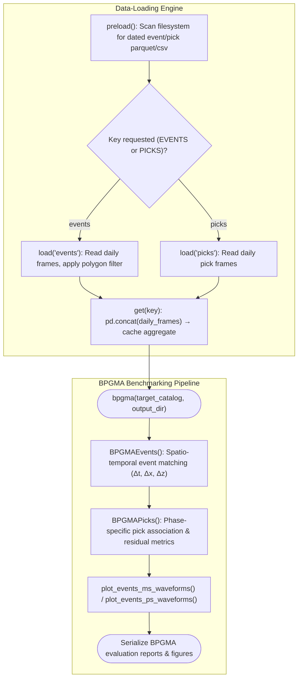

# Pseudocode Map: OGSCatalog

## Purpose
Lazy-loading container for OGS daily event and pick catalogs. Indexes dated files beneath an OGS run directory, loads daily event and pick tables on demand, materializes aggregate `EVENTS` and `PICKS` DataFrames, applies spatial polygon filtering, produces seismic diagnostic plots, and computes BPGMA benchmark comparisons.

## Current Execution Flow


## Pseudocode
```text
class OGSCatalog:
  field input: Path
  field events_: Dict(Date, Path)
  field picks_: Dict(Date, Path)
  field events: Dict(Date, DataFrame)
  field picks: Dict(Date, DataFrame)
  field EVENTS: Option(DataFrame)
  field PICKS: Option(DataFrame)

  method preload() ⟶ None:
    ∀ date ∈ [self.start .. self.end]:
      path_ev ← find_dated_file(self.input / "events", date)
      if path_ev ≠ None then:
        self.events_[date] ← path_ev
      path_pk ← find_dated_file(self.input / "picks", date)
      if path_pk ≠ None then:
        self.picks_[date] ← path_pk

  method get(key: String) ⟶ DataFrame:
    if key = "events" then:
      if self.EVENTS = None then:
        self.load("events")
        self.EVENTS ← concat(self.events.values())
      ⟵ self.EVENTS
    else if key = "picks" then:
      if self.PICKS = None then:
        self.load("picks")
        self.PICKS ← concat(self.picks.values())
      ⟵ self.PICKS

  method bpgma(target: OGSCatalog, output: Option(Path)) ⟶ None:
    self.BPGMAEvents(target, output)
    self.BPGMAPicks(target, output)
    self.plot(targets=[target])
```

## State and Responsibilities
| Field / Method | Responsibility | Epistemic Status |
|:---|:---|:---|
| `preload()` | Discovers dated partition files without loading table payloads | **observed** ([OGS/src/ogscatalog.py:252-253](OGS/src/ogscatalog.py#L252-L253)) |
| `load(key)` | Lazily reads daily tables with optional spatial polygon bounding | **observed** ([OGS/src/ogscatalog.py:254-255](OGS/src/ogscatalog.py#L254-L255)) |
| `get(key)` | Concatenates and caches unified `EVENTS` or `PICKS` DataFrames | **observed** ([OGS/src/ogscatalog.py:258-259](OGS/src/ogscatalog.py#L258-L259)) |
| `bpgma()` | Benchmarking engine comparing candidate and target seismic catalogs | **observed** ([OGS/src/ogscatalog.py:280](OGS/src/ogscatalog.py#L280)) |

## Tests and Evidence
- Documented and validated in [LLM/01_context/pipeline_map.md](LLM/01_context/pipeline_map.md).

