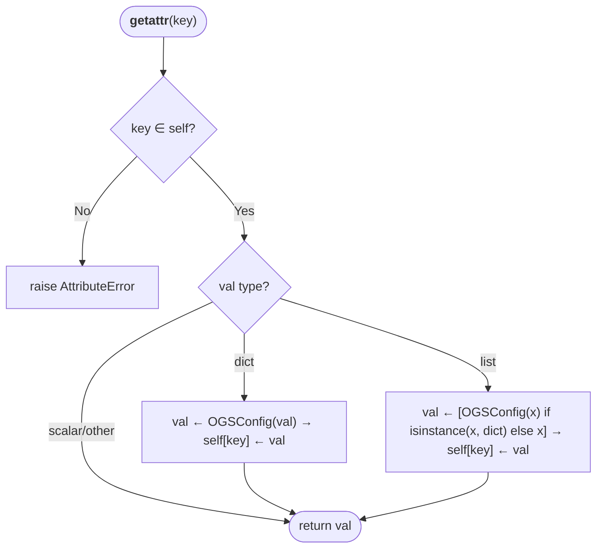

# Pseudocode Map: OGSConfig

## Purpose
Dictionary subclass providing recursive dot-attribute access (`cfg.attribute`) for hierarchical configuration trees, automatically promoting nested dictionaries and lists of dictionaries to `OGSConfig` instances.

## Current Execution Flow


## Pseudocode
```text
class OGSConfig extends Dict:
  method __getattr__(key: String) ⟶ Any:
    if key ∉ self then:
      raise AttributeError("OGSConfig has no attribute " ⧺ key)
    val ← self[key]
    if val is Dict ∧ ¬(val is OGSConfig) then:
      val ← OGSConfig(val)
      self[key] ← val
    else if val is List then:
      val ← [OGSConfig(item) if item is Dict ∧ ¬(item is OGSConfig) else item | item ∈ val]
      self[key] ← val
    ⟵ val

  method __setattr__(key: String, value: Any) ⟶ None:
    self[key] ← value

  method __delattr__(key: String) ⟶ None:
    if key ∉ self then:
      raise AttributeError("OGSConfig has no attribute " ⧺ key)
    delete self[key]
```

## State and Responsibilities
| Field / Method | Responsibility | Epistemic Status |
|:---|:---|:---|
| `__getattr__()` | Transparent dot-lookup with on-demand recursive promotion | **observed** ([OGS/src/ogsconfig.py:48-64](OGS/src/ogsconfig.py#L48-L64)) |
| `__setattr__()` | Assigns dot-attribute to dictionary key | **observed** ([OGS/src/ogsconfig.py:66-67](OGS/src/ogsconfig.py#L66-L67)) |
| `__delattr__()` | Deletes attribute/key, translating `KeyError` to `AttributeError` | **observed** ([OGS/src/ogsconfig.py:69-73](OGS/src/ogsconfig.py#L69-L73)) |

## Tests and Evidence
- Verified in [OGS/test/testogsconfig.py:34-80](OGS/test/testogsconfig.py#L34-L80).

