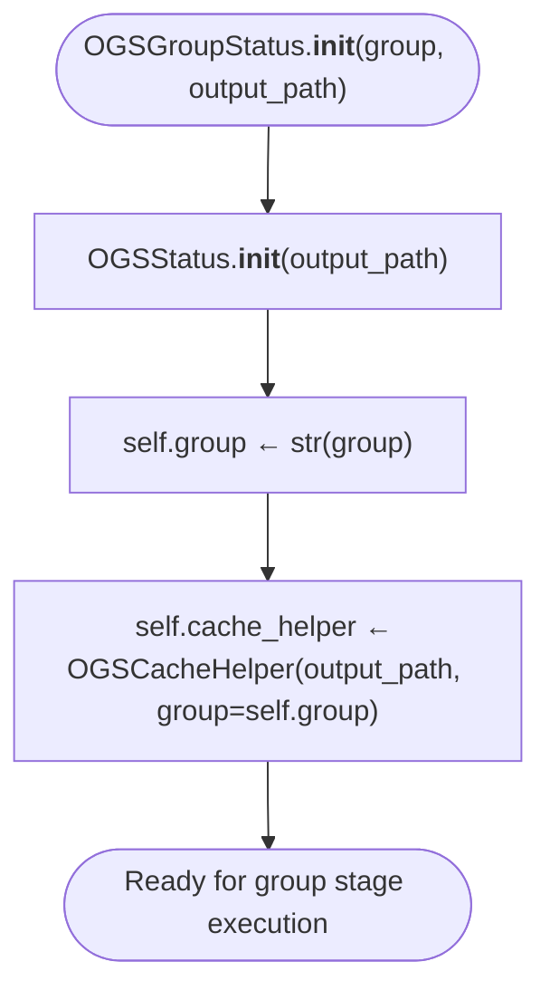

# Pseudocode Map: OGSGroupStatus

## Purpose
Specialized sub-state container bound to an individual partition group (e.g., calendar day `YYYY-MM-DD`), scoping cache paths to `<output_path>/<caller>/<param>/<group>.parquet`.

## Current Execution Flow


## Pseudocode
```text
class OGSGroupStatus extends OGSStatus:
  constructor(group: String, output_path: Path):
    super(output_path)
    self.group ← str(group)
    self.cache_helper ← OGSCacheHelper(self.output_path, group=self.group)
```

## State and Responsibilities
| Field / Method | Responsibility | Epistemic Status |
|:---|:---|:---|
| `self.group: str` | Group identifier (e.g. date) | **observed** ([OGS/src/ogsbase.py:199](OGS/src/ogsbase.py#L199)) |
| `self.cache_helper` | Scoped cache helper with `group=self.group` | **observed** ([OGS/src/ogsbase.py:200](OGS/src/ogsbase.py#L200)) |
| `set_param() / get_param()` | Inherited from `OGSStatus`, routes to group-level subpaths | **observed** ([OGS/src/ogsbase.py:144,185](OGS/src/ogsbase.py#L144)) |

## Tests and Evidence
- Verified in [OGS/test/testogsbase.py:122-146](OGS/test/testogsbase.py#L122-L146).
