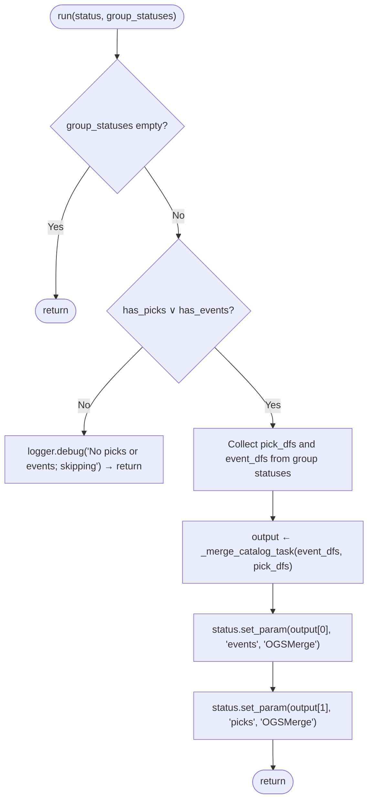

# Pseudocode Map: OGSMerge

## Purpose
Polymorphically unifies catalog events and phase picks across multiple group DAGs (`OGSGroupStatus`), concatenating DataFrames, generating continuous index sequences (`idx`), preserving local group indices (`idx_in_group`), re-linking picks to unified event IDs, and storing the unified catalog into the global `OGSStatus`.

## Current Execution Flow


## Pseudocode
```text
function run(status: OGSStatus, group_statuses: Option(List(OGSGroupStatus))) ⟶ None:
  if ¬group_statuses then:
    ⟵
  has_picks ← ∃ s ∈ group_statuses : "picks" ∈ s._parameters ∧ s._parameters["picks"][0] ≠ None
  has_events ← ∃ s ∈ group_statuses : "events" ∈ s._parameters ∧ s._parameters["events"][0] ≠ None

  if ¬has_picks ∧ ¬has_events then:
    logger.debug("No picks or events; skipping merge.")
    ⟵

  pick_dfs ← [s.get_param("picks") | s ∈ group_statuses if has_picks]
  event_dfs ← [s.get_param("events") | s ∈ group_statuses if has_events]

  ⟨merged_events, merged_picks⟩ ← _merge_catalog_task(event_dfs, pick_dfs)

  if has_events then:
    status.set_param(merged_events, "events", self.name)
  if has_picks then:
    status.set_param(merged_picks, "picks", self.name)
```

## State and Responsibilities
| Field / Method | Responsibility | Epistemic Status |
|:---|:---|:---|
| `output_keys()` | Declares `["picks", "events"]` | **observed** ([OGS/src/ogsbase.py:323-324](OGS/src/ogsbase.py#L323-L324)) |
| `run()` | Coordinates extraction, indexing, and Dask task creation | **observed** ([OGS/src/ogsbase.py:326-368](OGS/src/ogsbase.py#L326-L368)) |
| `_merge_catalog_task()` | Dask-delayed concatenation, sort by time, index renumbering, pick-to-event association | **observed** ([OGS/src/ogsbase.py:226-311](OGS/src/ogsbase.py#L226-L311)) |

## Tests and Evidence
- Standalone picks unification: [OGS/test/testogsbase.py:119-158](OGS/test/testogsbase.py#L119-L158).
- Standalone events unification: [OGS/test/testogsbase.py:159-198](OGS/test/testogsbase.py#L159-L198).
- Joint catalog and pick reindexing: [OGS/test/testogsbase.py:199-272](OGS/test/testogsbase.py#L199-L272).
- Full pipeline integration: [OGS/test/testogsbuilder.py:74-128](OGS/test/testogsbuilder.py#L74-L128).
