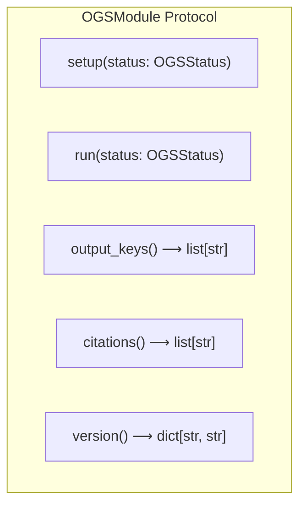

# Pseudocode Map: OGSModule

## Purpose
Abstract base class defining the execution protocol, artifact contract, academic citations, and version reporting for all pipeline modules (pickers, associators, locators, and mergers).

## Current Execution Flow


## Pseudocode
```text
abstract class OGSModule:
  field name: String

  constructor(**kwargs):
    self.name ← self.__class__.__name__

  method setup(status: OGSStatus) ⟶ None:
    pass

  abstract method run(status: OGSStatus) ⟶ None:
    pass

  method output_keys() ⟶ List(String):
    ⟵ []

  method citations() ⟶ List(String):
    ⟵ []

  method version() ⟶ Dict(String, String):
    ⟵ {}
```

## State and Responsibilities
| Field / Method | Responsibility | Epistemic Status |
|:---|:---|:---|
| `self.name` | Module identifier for logging and artifact namespace | **observed** ([OGS/src/ogsbase.py:207](OGS/src/ogsbase.py#L207)) |
| `setup(status, *args, **kwargs)` | Environmental initialization hook (e.g. loading inventories) | **observed** ([OGS/src/ogsbase.py:209-210](OGS/src/ogsbase.py#L209-L210)) |
| `run(status, *args, **kwargs)` | Core stage computation entrypoint | **observed** ([OGS/src/ogsbase.py:212-214](OGS/src/ogsbase.py#L212-L214)) |
| `output_keys()` | Manifest of parameter keys written by this module | **observed** ([OGS/src/ogsbase.py:216-217](OGS/src/ogsbase.py#L216-L217)) |

## Tests and Evidence
- Implemented by `MockPickerModule` ([OGS/test/testogsbuilder.py:52-69](OGS/test/testogsbuilder.py#L52-L69)).
- Implemented by `OGSSeisBenchPicker` ([OGS/src/ogspicker.py:276-373](OGS/src/ogspicker.py#L276-L373)).
- Implemented by `OGSMerge` ([OGS/src/ogsbase.py:314-368](OGS/src/ogsbase.py#L314-L368)).
- Verified by unit test suite in [OGS/test/testogsbase.py](OGS/test/testogsbase.py) and [OGS/test/testogsbuilder.py](OGS/test/testogsbuilder.py).
