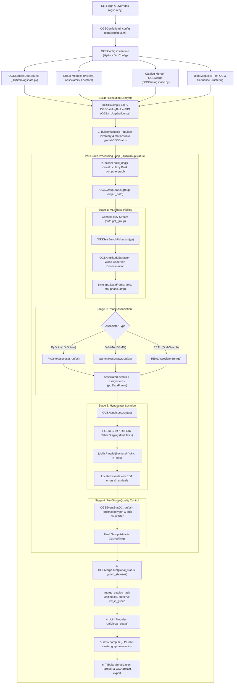

# Pseudocode Map: OGSPipeline

## Purpose
Comprehensive architecture map specifying how the complete OGS seismicity analysis pipeline is constructed from each modular dependency: configuration loading ([`OGSConfig`](OGS/src/ogsconfig.py)), waveform data sourcing ([`OGSSquirrelDataSource`](OGS/src/ogsdata.py)), group-level phase picking ([`OGSSeisBenchPicker`](OGS/src/ogspicker.py)), phase association ([`PyOctoAssociator`](OGS/conf/group_modules/associator/ogspyocto.yaml), [`GammaAssociator`](OGS/conf/group_modules/associator/ogsgamma.yaml), [`REALAssociator`](OGS/src/real.py)), hypocenter location ([`OGSNonLinLoc`](OGS/src/ogsnonlinloc.py)), multi-group catalog merging ([`OGSMerge`](OGS/src/ogsbase.py)), unified DAG orchestration ([`OGSCatalogBuilder`](OGS/src/ogsbuilder.py) / [`OGSCatalogBuilderMPI`](OGS/src/ogsbuilderMPI.py)), and universal command-line dispatch ([`ogsrun`](OGS/src/ogsrun.py)).

## Component Dependency Architecture



## Pseudocode

```text
function run_pipeline(config_dir, config_name, overrides, force_mpi) ⟶ Option(OGSStatus):
  # 1. Configuration Resolution
  cfg ← load_config(config_dir, config_name, overrides)
  
  # 2. Squirrel Pre-indexing Barrier
  if cfg.get("index_only", False) then:
    data_obj ← instantiate(cfg.data)
    data_obj.index_parallel()
    ⟵ None

  # 3. Component Instantiation from Modular Dependencies
  data ← instantiate(cfg.data)
  group_modules ← instantiate(cfg.group_modules)
  merge_module ← instantiate(cfg.merge_module)  # Defaults to OGSMerge()
  joint_modules ← instantiate(cfg.joint_modules)
  output_path ← cfg.get("output_path", "catalog/OGS")

  # 4. Builder Selection & Cluster Bootstrap
  is_mpi ← force_mpi ∨ is_mpi_environment()
  builder_cls ← (OGSCatalogBuilderMPI if is_mpi else OGSCatalogBuilder)
  builder ← builder_cls(
      output_path=output_path,
      data=data,
      group_modules=group_modules,
      merge_module=merge_module,
      joint_modules=joint_modules,
      outputs=cfg.get("outputs", ["picks", "events", "assignments"]),
      formats=cfg.get("formats", ["parquet", "csv"])
  )

  # 5. Pipeline Setup
  builder.setup():
    data.populate_status(global_status)
    for mod in (group_modules + [merge_module] + joint_modules):
      mod.setup(global_status)

  # 6. DAG Construction across Groups and Stages
  ⟨global_status, group_statuses⟩ ← builder.build_dag():
    for group in data.groups():
      gs ← OGSGroupStatus(group, output_path)
      gs.update(global_status)
      gs.set_param(functools.partial(data.get_group, group), "data_func")
      
      # Group-level execution sequence
      for mod in group_modules:
        # Stage 1: Picker (OGSSeisBenchPicker)
        # Stage 2: Associator (PyOcto / GaMMA / REAL)
        # Stage 3: Locator (OGSNonLinLoc 1D / 3D)
        # Stage 4: Per-group QC (OGSEventStatQC)
        mod.run(gs)
        
      group_statuses.append(gs)
    
    # Cross-group merge stage
    merge_module.run(global_status, group_statuses)

    # Global joint post-processing stage
    for mod in joint_modules:
      mod.run(global_status)

  # 7. Compute & Persistence
  dask.compute(all requested delayed parameters)
  serialize DataFrames to Parquet and CSV in output_path
  ⟵ global_status
```

## Dependency Wiring & Module Manifest

| Dependency Component | Owning Class / Module | Role & Contract in Pipeline | Epistemic Status |
|:---|:---|:---|:---|
| **Configuration Engine** | [`OGSConfig`](OGS/src/ogsconfig.py) | Resolves hierarchical YAML configs, parses Makefile overrides (`+libpath=.`), and dynamically instantiates objects via `_target_` | **observed** ([OGS/src/ogsconfig.py:46-170](OGS/src/ogsconfig.py#L46-L170)) |
| **Waveform Data Source** | [`OGSSquirrelDataSource`](OGS/src/ogsdata.py) | Discovers station inventories, channels, daily waveform chunks, and provides `get_group(group)` iterator stream | **observed** ([OGS/src/ogsdata.py:165-385](OGS/src/ogsdata.py#L165-L385)) |
| **Execution State & Cache** | [`OGSStatus`](OGS/src/ogsbase.py), [`OGSCacheHelper`](OGS/src/ogsbase.py) | Key-value artifact registry supporting lazy Dask compute graphs, in-memory payloads, and persistent disk caching | **observed** ([OGS/src/ogsbase.py:53-189](OGS/src/ogsbase.py#L53-L189)) |
| **Group Partition State** | [`OGSGroupStatus`](OGS/src/ogsbase.py) | Subclass of `OGSStatus` scoped to a temporal group (e.g. daily interval), managing isolated group-level cache directories | **observed** ([OGS/src/ogsbase.py:192-201](OGS/src/ogsbase.py#L192-L201)) |
| **Module Protocol** | [`OGSModule`](OGS/src/ogsbase.py) | Extensible abstract base class enforcing Polymorphic Unification (`setup`, `run`, `output_keys`, `citations`, `version`) | **observed** ([OGS/src/ogsbase.py:203-224](OGS/src/ogsbase.py#L203-L224)) |
| **Deep Learning Picker** | [`OGSSeisBenchPicker`](OGS/src/ogspicker.py) | Wraps neural picking models (PhaseNet, EQTransformer) and evaluates waveform windows with optional Wood-Anderson amplitude extraction | **observed** ([OGS/src/ogspicker.py:276-373](OGS/src/ogspicker.py#L276-L373)) |
| **Phase Associators** | [`PyOctoAssociator`](OGS/conf/group_modules/associator/ogspyocto.yaml), [`GammaAssociator`](OGS/conf/group_modules/associator/ogsgamma.yaml), [`REALAssociator`](OGS/src/real.py) | Clusters raw picks into discrete seismic events; binds phase arrivals to candidate hypocenters | **observed** ([OGS/src/real.py:1-60](OGS/src/real.py#L1-L60), [`OGS/conf/group_modules/associator/`](OGS/conf/group_modules/associator/)) |
| **Hypocenter Locator** | [`OGSNonLinLoc`](OGS/src/ogsnonlinloc.py) | Non-linear probabilistic earthquake relocation with POSIX file-locked table staging (`NLLOC_SHM_DIR`) and dynamic `joblib` worker allocation | **observed** ([OGS/src/ogsnonlinloc.py:1-60](OGS/src/ogsnonlinloc.py#L1-L60)) |
| **Catalog Merger** | [`OGSMerge`](OGS/src/ogsbase.py) | Gathers group DataFrames, unifies pick indices (`idx`), maps event associations across days, and assigns global catalog tables | **observed** ([OGS/src/ogsbase.py:314-368](OGS/src/ogsbase.py#L314-L368)) |
| **Pipeline Builder** | [`OGSCatalogBuilder`](OGS/src/ogsbuilder.py) | Assembles the end-to-end DAG, connects lazy data streams, dispatches stage modules, and exports Parquet/CSV artifacts | **observed** ([OGS/src/ogsbuilder.py:48-285](OGS/src/ogsbuilder.py#L48-L285)) |
| **Cluster MPI Orchestrator** | [`OGSCatalogBuilderMPI`](OGS/src/ogsbuilderMPI.py) | Extends `OGSCatalogBuilder` with Leonardo Slurm rank GPU pinning (`CUDA_VISIBLE_DEVICES = local_rank % 4`) and Dask-MPI cluster bootstrapping | **observed** ([OGS/src/ogsbuilderMPI.py:48-135](OGS/src/ogsbuilderMPI.py#L48-L135)) |
| **CLI Runner** | [`OGSRun`](OGS/src/ogsrun.py) | Universal CLI entrypoint coordinating argument parsing, Squirrel index barriers, builder selection, and process execution | **observed** ([OGS/src/ogsrun.py:52-243](OGS/src/ogsrun.py#L52-L243)) |

## Tests and Evidence
- End-to-end mock pipeline DAG: [OGS/test/testogsbuilder.py:74-128](OGS/test/testogsbuilder.py#L74-L128).
- Distributed MPI bootstrapping and GPU pinning: [OGS/test/testogsbuilder.py:131-228](OGS/test/testogsbuilder.py#L131-L228).
- End-to-end picker with real PhaseNet model on synthetic streams: [OGS/test/testogspicker.py:305-358](OGS/test/testogspicker.py#L305-L358).
- NonLinLoc table staging and execution: [OGS/test/testogsnonlinloc.py](OGS/test/testogsnonlinloc.py).
- Hydra config resolution and instantiation: [OGS/test/testogsconfig.py](OGS/test/testogsconfig.py).

