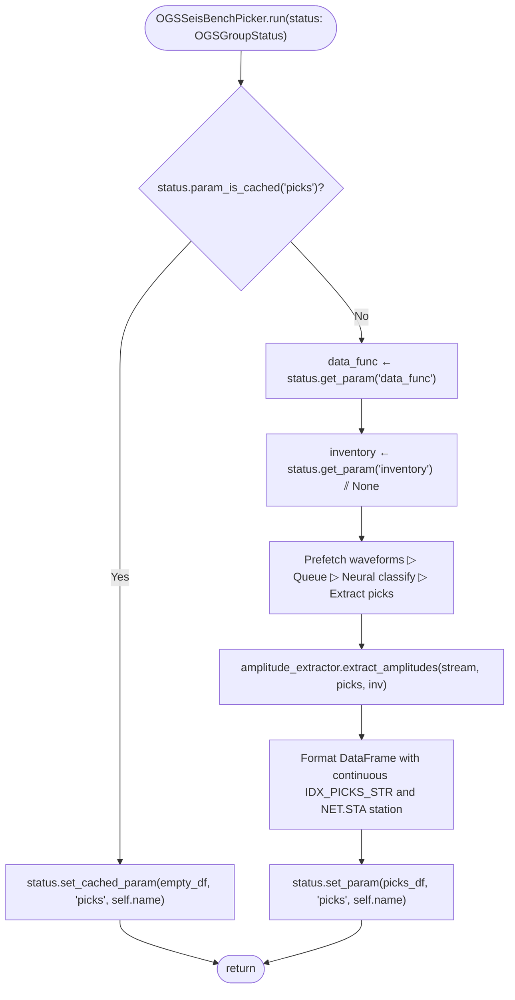

# Pseudocode Map: OGSSeisBenchPicker

## Purpose
Pipeline stage wrapping SeisBench deep learning phase pickers (PhaseNet, EQTransformer) with asynchronous waveform prefetching, GPU CUDA worker pinning, lazy Dask graph scheduling, and Wood-Anderson amplitude extraction.

## Current Execution Flow


## Pseudocode
```text
class OGSSeisBenchPicker extends OGSModule:
  field model: SeisBenchModel
  field amplitude_extractor: Option(OGSAmplitudeExtractor)

  method output_keys() ⟶ List(String):
    ⟵ ["picks"]

  method run(status: OGSGroupStatus) ⟶ None:
    if status.param_is_cached("picks", self.name) then:
      status.set_cached_param(empty_df, "picks", self.name)
      ⟵

    data_func ← status.get_param("data_func")
    inv ← status.get_param("inventory") ⫽ None

    picks_raw ← self._load_data_get_pick(
        data_func=data_func,
        model=self.model,
        inventory=inv,
        amplitude_extractor=self.amplitude_extractor,
        group=status.group
    )
    status.set_param(picks_raw, "picks", self.name)
```

## State and Responsibilities
| Field / Method | Responsibility | Epistemic Status |
|:---|:---|:---|
| `self.model` | Loaded SeisBench neural picking architecture | **observed** ([OGS/src/ogspicker.py:293](OGS/src/ogspicker.py#L293)) |
| `self.amplitude_extractor` | Optional Wood-Anderson amplitude measuring component | **observed** ([OGS/src/ogspicker.py:298-306](OGS/src/ogspicker.py#L298-L306)) |
| `run(status, *args, **kwargs)` | Executes neural inference pipeline and publishes picks table | **observed** ([OGS/src/ogspicker.py:338-373](OGS/src/ogspicker.py#L338-L373)) |
| `citations()` | Formats BibTeX citations for SeisBench and model weights | **observed** ([OGS/src/ogspicker.py:310-330](OGS/src/ogspicker.py#L310-L330)) |

## Tests and Evidence
- Registered in picker Hydra configuration: [`OGS/conf/group_modules/picker/ogsseisbenchpicker.yaml`](OGS/conf/group_modules/picker/ogsseisbenchpicker.yaml).
- Integration test in [OGS/test/testogsbuilder.py](OGS/test/testogsbuilder.py).
- Picker test suite in [OGS/test/testogspicker.py](OGS/test/testogspicker.py).

