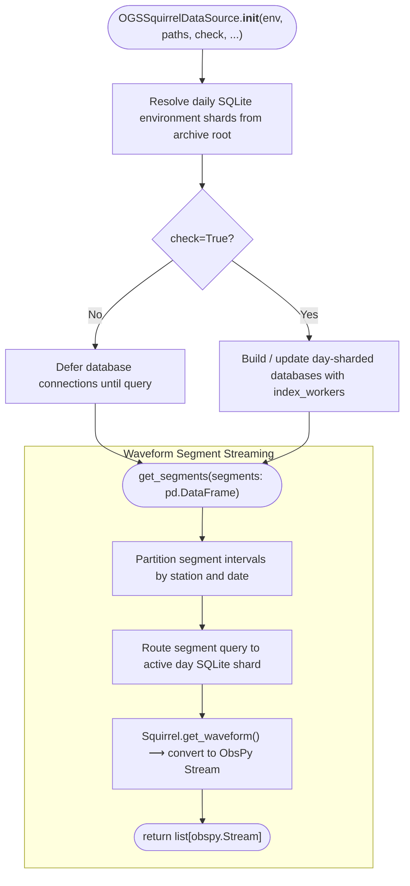

# Pseudocode Map: OGSSquirrelDataSource

## Purpose
High-performance seismic data source backed by Pyrocko Squirrel, optimizing waveform queries on large archives via daily SQLite database sharding, filesystem pruning, and temporary local environment caching for read-only cluster filesystems.

## Current Execution Flow


## Pseudocode
```text
class OGSSquirrelDataSource extends OGSAbstractDataSource:
  field env: String
  field day_envs: Dict(Date, Path)
  field copy_to_tmp: Bool
  field channel_priorities: List(String)

  constructor(env, paths, check, copy_to_tmp, ...):
    super(...)
    self.env ← env
    self.copy_to_tmp ← copy_to_tmp
    self.day_envs ← discover_day_shards(self.env)
    if check then:
      self.update_shards()

  method get_segments(segments: DataFrame) ⟶ List(Stream):
    streams ← []
    ∀ row ∈ segments:
      day ← to_date(row.starttime)
      sq ← self.get_squirrel_for_day(day)
      wfs ← sq.get_waveforms(
          codes=row.station,
          tmin=row.starttime,
          tmax=row.endtime,
          channel_priorities=self.channel_priorities
      )
      streams.append(to_obspy(wfs))
    ⟵ streams
```

## State and Responsibilities
| Field / Method | Responsibility | Epistemic Status |
|:---|:---|:---|
| `self.day_envs` | Dictionary mapping calendar dates to daily SQLite shard databases | **observed** ([OGS/src/ogsdata.py:985-986](OGS/src/ogsdata.py#L985-L986)) |
| `groups()` | Discovers and returns daily group timestamps | **observed** ([OGS/src/ogsdata.py:1020-1040](OGS/src/ogsdata.py#L1020-L1040)) |
| `get_group()` | Provides daily data callback closure for SeisBench pickers | **observed** ([OGS/src/ogsdata.py:1050-1075](OGS/src/ogsdata.py#L1050-L1075)) |
| `get_segments()` | Slices and converts Squirrel waveform segments to ObsPy Streams | **observed** ([OGS/src/ogsdata.py:1300-1360](OGS/src/ogsdata.py#L1300-L1360)) |

## Tests and Evidence
- Documented in [LLM/01_context/pipeline_map.md](LLM/01_context/pipeline_map.md).

