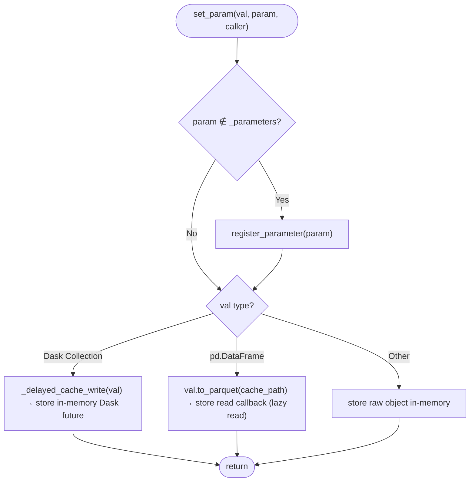

# Pseudocode Map: OGSStatus

## Purpose
Acts as the global state container across pipeline stages, managing registered parameters, lazy Dask task graphs, and parquet cache read/write transitions.

## Current Execution Flow


## Pseudocode
```text
function set_param(val: Any, param: String, caller: Option(String)) ⟶ None:
  if param ∉ self._parameters then:
    self.register_parameter(param, duplicate=⊤)
  drop_group ← ¬(self is OGSGroupStatus)
  cache_kwargs ← {param: param, caller: caller, drop_group: drop_group, suffix: ".parquet"}
  if is_dask_collection(val) then:
    val_delayed ← _delayed_cache_write(val, cache_kwargs, self.cache_helper)
    self._parameters[param] ← ⟨val_delayed, _identity, ⊤⟩
  else if val is pd.DataFrame then:
    path ← self.cache_helper.resolve_path(**cache_kwargs)
    path.parent.mkdir(parents=⊤, exist_ok=⊤)
    val.to_parquet(path, index=⊥)
    self._parameters[param] ← ⟨cache_kwargs, pd.read_parquet, ⊥⟩
  else:
    self._parameters[param] ← ⟨val, _identity, ⊤⟩

function get_param(param: String) ⟶ Any:
  if param ∉ self._parameters then:
    raise KeyError("Parameter not registered")
  ⟨payload, read_func, in_memory⟩ ← self._parameters[param]
  if payload = None then:
    raise ValueError("Parameter not set yet")
  if in_memory then:
    ⟵ payload
  path ← self.cache_helper.resolve_path(**payload)
  ⟵ read_func(path)
```

## State and Responsibilities
| Field / Method | Responsibility | Epistemic Status |
|:---|:---|:---|
| `self._parameters` | Dictionary of `(payload, read_func, in_memory)` tuples | **observed** ([OGS/src/ogsbase.py:113](OGS/src/ogsbase.py#L113)) |
| `register_parameter()` | Declares required parameter keys | **observed** ([OGS/src/ogsbase.py:115-120](OGS/src/ogsbase.py#L115-L120)) |
| `set_param()` | Polymorphic persistence: writes DataFrame to disk or creates Dask task | **observed** ([OGS/src/ogsbase.py:138-161](OGS/src/ogsbase.py#L138-L161)) |
| `get_param()` | Materializes or loads parameter on demand | **observed** ([OGS/src/ogsbase.py:173-183](OGS/src/ogsbase.py#L173-L183)) |
| `param_is_cached()` | Checks if on-disk Parquet artifact already exists | **observed** ([OGS/src/ogsbase.py:184-189](OGS/src/ogsbase.py#L184-L189)) |

## Tests and Evidence
- Verified in [OGS/test/testogsbase.py:72-114](OGS/test/testogsbase.py#L72-L114).
